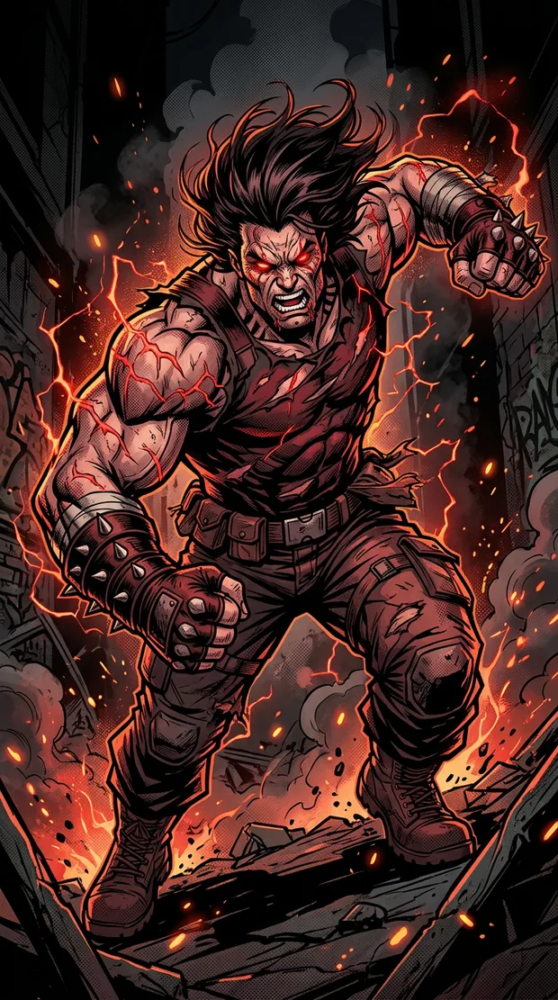

# SUPER CLASH

A premium 2D comic-book superhero card battler that runs entirely in the browser.

Two fighters. Twenty health. Five rounds. Both players pick a hero in secret, reveal
together, and let the clash resolve.



---

## Quick start

```bash
npm install
npm run dev        # http://localhost:5173
npm run build      # production bundle in dist/
npm run preview    # serve the production bundle on :4173
npm test           # 102 unit tests
npm run lint       # oxlint — 0 warnings, 0 errors
```

Requires Node 20+ (verified on Node 22).

Deploy: `npm run build` emits a fully static `dist/`. Upload it to any static host
(Netlify, Vercel, GitHub Pages, S3, nginx). No server, no environment variables,
no external API calls. If you host it under a sub-path, set `base` in
`vite.config.ts`.

---

## Implemented features

### Core loop
- **Simultaneous hidden selection.** Both fighters commit one hero per round; neither
  card is rendered until both have confirmed.
- **20 HP · 8-card deck · 3-card hand · 5 rounds.** Played cards are removed from the
  hand and cannot be reused for the rest of the match.
- **Knockout ends the match instantly.** After five rounds the higher HP wins; equal
  HP is a draw.
- **Energy economy** (5 start, +3 per round, cap 12). If nothing in hand is affordable,
  the cheapest card plays free so a duel can never stall.

### Modes
- **Solo Clash** — adaptive A.I. with three difficulties (Rookie / Hero / Legend). The
  AI scores its legal cards against the opponent's *public* history; it never reads
  the player's hidden pick.
- **Local Duel** — two players on one device. Player 1 confirms, a handoff overlay
  seals the device, Player 2 picks on a clean board, then both cards flip together.

### Combat
Sixteen original heroes across five classes (Tank, Fighter, Speed, Tactician, Special),
each with one deterministic signature ability. No dice rolls decide a round.

| Hero | Class | Ability | Rule |
|---|---|---|---|
| Ironclad | Tank | Aegis Plating | Incoming damage −3, but a connecting hit always chips 1 |
| Bulwark | Tank | Last Bastion | +3 DEF at 10 HP or less |
| Mammoth | Tank | Frostbind | Slows the opposing card by 3 SPD for that clash |
| Ravager | Fighter | Bloodrage | +4 ATK at 10 HP or less |
| Kairo | Fighter | Duelist's Pride | +2 ATK when the opposing card's ATK is higher |
| Grav-Lord | Fighter | Crushing Gravity | +ATK equal to half the opposing DEF |
| Zephyra | Speed | Afterimage | Once per match, evades a whole hit (5+ damage or 8 HP or less) |
| Voltrex | Speed | Static Charge | +2 ATK while holding the speed advantage |
| Shiv | Speed | Blink Strike | Ignores the opposing DEF entirely |
| Sentinel | Tactician | Countermeasures | +3 ATK vs. a class the opponent played last round |
| Echo | Tactician | Riposte | Counterattacks for 3 when fully blocked |
| Oracle | Tactician | Precognition | +2 DEF and denies the opponent's speed bonus |
| Pyroclast | Special | Ignition | Target burns 2 damage for the next 2 rounds |
| Prism | Special | Refraction | Reflects 2 damage back at the attacker |
| Thornwild | Special | Regrowth | Heals 2 HP after taking damage in a clash |
| Arcwraith | Special | Overcharge | Adds 2 unavoidable arc damage |

### Presentation
- Comic-book design system: halftone fields, ink panels, skewed captions, SFX lettering.
- Full reveal choreography: card slam, impact flash, damage numbers, screen shake,
  health-bar drain, burn/heal ticks, KO badge.
- A clear **round breakdown** after every clash: ATK/DEF totals, bonuses applied,
  damage through, and plain-language explanation lines.
- Rarity-specific card frames (common → legendary) with per-hero accent colours.
- **Procedural audio** — every sound effect and the looping music bed are synthesised
  with the Web Audio API. No licensed or downloaded audio.
- Responsive from 360 px phones to desktop, no horizontal overflow at any breakpoint.
- `prefers-reduced-motion` support plus an in-game reduced-motion toggle.

### Meta
- Hero archive with search and class/rarity filters, plus per-hero play/win records.
- Deck builder: 8 slots, energy guardrails, presets, randomise, validation messages.
- Settings: mute, music/SFX volume, screen shake, reduced motion, player name,
  default difficulty, statistics reset, full data reset.
- Career stats (matches, wins, losses, draws, best hit, streaks) persisted in
  `localStorage`, along with settings, decks and unlocks.

---

## Architecture

Game logic is completely independent of React and is pure/deterministic, which is what
makes it testable.

```
src/
├─ game/                    ← zero React imports
│  ├─ types.ts              Domain types (cards, match state, outcomes, beats)
│  ├─ balance.ts            Every tunable number in one place
│  ├─ combat.ts             resolveRound() — pure simultaneous clash resolver
│  ├─ engine.ts             Match state machine + actions (createMatch, selectCard,
│  │                        commitRound, advanceRound, handoff, publicView)
│  ├─ ai.ts                 Heuristic AI scoring with difficulty tuning
│  ├─ storage.ts            Settings / stats / decks / unlocks + validation
│  ├─ data/heroes.ts        The 16-card roster (add heroes here)
│  ├─ data/abilities.ts     Ability rules text and FX metadata
│  ├─ data/meta.ts          Class + rarity metadata
│  └─ __tests__/            102 tests
├─ components/
│  ├─ cards/                HeroCard, HeroArt, CardDetail, Stats
│  ├─ battle/               HealthBar, CombatLog, RoundTracker
│  ├─ common/               Buttons
│  └─ layout/               ScreenHeader
├─ screens/                 MainMenu, ModeSelect, DeckSelect, BattleScreen,
│                           MatchResult, Collection, SettingsScreen, HowToPlay
├─ audio/sound.ts           Procedural Web Audio engine
└─ styles/                  tokens.css, comic.css, app.css
```

### Combat resolution order

`resolveRound()` in `src/game/combat.ts` follows a fixed, documented order:

1. Both cards are revealed by the caller.
2. Passive abilities (Last Bastion, Bloodrage).
3. Speed effects (Frostbind) and initiative (+2 ATK at a 3+ speed edge).
4. Conditional bonuses (Duelist, Crushing Gravity, Countermeasures, Blink Strike, Overcharge).
5. Attack and defence totals.
6. Damage: `max(0, ATK + bonuses − DEF − bonuses)`, then Aegis absorption, then dodges.
7. Reactive abilities (Refraction, Riposte) from the same clash state.
8. Status effects: burn ticks and Regrowth.
9. Health clamp and knockouts.

The resolver is pure and symmetric — inputs are never mutated and both sides are
computed from identical pre-clash state, so evaluation order cannot bias the result.
It also emits a `beats[]` presentation timeline and a `headline` so the UI stages the
reveal without duplicating any rules.

### Privacy boundary

`publicView(state, viewer)` is the only sanctioned way for the UI to read a match.
It returns the viewer's own pick, the opponent's pick **only after a reveal**, and a
boolean "opponent is ready". The local-duel screen additionally renders P1's committed
card as a *sealed* plate, so the card face never exists in the DOM before the reveal.
This is covered by unit tests and was audited in a real browser.

---

## Verification

### Automated

```
Test Files  3 passed (3)
     Tests  102 passed (102)
```

Coverage highlights:
- damage and defence maths, minimum chip damage, symmetric resolution
- every one of the 16 abilities (trigger, non-trigger, stacking, expiry)
- card removal, no reuse, hand draw, energy spend and the free-play rescue
- hidden selection: rejected inactive side, rejected off-hand card, no double pick
- local 2P privacy at the model level and through the rendered DOM
- AI: always legal, deterministic, changes with public state, ignores the hidden pick
- full 5-round matches, early KO, five-round health decision, draw, no negative HP
- deck validation: size, duplicates, unknown ids, energy spread, sanitising bad saves
- roster integrity: unique ids/names/monograms, every class and rarity represented,
  every ability used once, ability text must state a trigger

### Manual / browser (Chromium, driven headlessly)

| Check | Result |
|---|---|
| Full Solo Clash, start → match result | Pass (5 rounds, stats persisted) |
| Full Local Duel, start → match result | Pass (4–5 rounds) |
| P1 card face hidden during handoff & P2 turn | Pass (DOM audit, no image or name) |
| Both cards flip together after Lock In | Pass |
| Restart / rematch from result screen | Pass |
| Navigation across all 8 screens | Pass |
| Console errors during full runs | None |
| Horizontal overflow at 360, 390, 820, 1440 px | None |
| Production build served and played | Pass |
| Accessibility: alt/aria on controls, single h1, lang | Pass |
| Static analysis: `tsc -b` + `oxlint` | 0 errors, 0 warnings |

---

## Known limitations

1. **Seven heroes ship with emblem plates instead of portraits.** Ironclad, Bulwark,
   Mammoth, Ravager, Kairo, Grav-Lord, Zephyra, Voltrex and Shiv have full comic
   portraits. Sentinel, Echo, Oracle, Pyroclast, Prism, Thornwild and Arcwraith
   currently render a designed class-emblem fallback. Dropping a file at the card's
   `artwork` path and adding the id to `HERO_ART_AVAILABLE` in
   `src/game/data/heroes.ts` switches it to the portrait automatically.
2. **No online multiplayer** — explicitly out of scope for v1.
3. **No economy, pack opening or payments.** All 16 heroes are unlocked; the
   `unlocks` store and collection filter already support gating if that is added.
4. **Music is a single procedural loop**, not a composed score.
5. **The AI sees the opponent's hand composition only through revealed cards.** It
   does not model the specific deck list, which keeps it fair but slightly beatable
   by a player who tracks their own deck well.

---

## Testing your own balance changes

All tunables live in `src/game/balance.ts`; hero stats live in
`src/game/data/heroes.ts`. After editing, run `npm test` — the roster tests enforce
that decks remain legal and that the energy economy cannot lock a five-round match.

---

## Credits and licensing

- Code: original, written for this project.
- Characters, names and designs: original creations. No licensed IP is used.
- Artwork: AI-generated original illustrations.
- Audio: synthesised at runtime by the Web Audio API — no third-party samples.
- Fonts: [Bangers](https://fonts.google.com/specimen/Bangers) and
  [Barlow Condensed](https://fonts.google.com/specimen/Barlow+Condensed), both SIL
  Open Font License 1.1, self-hosted via `@fontsource`.
- Icons: [Lucide](https://lucide.dev), ISC License.

If you intend to commercialise this, re-check the licence terms of the font and icon
packages and the provenance of any artwork you add yourself.
